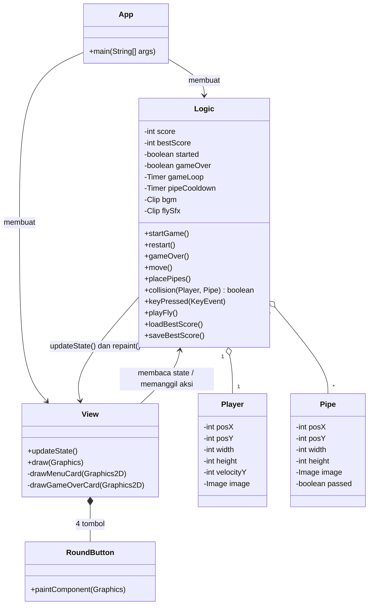
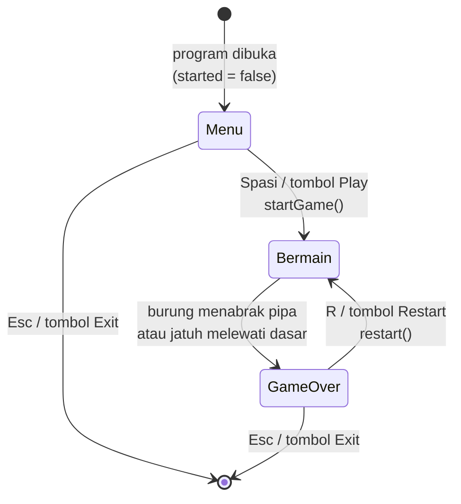
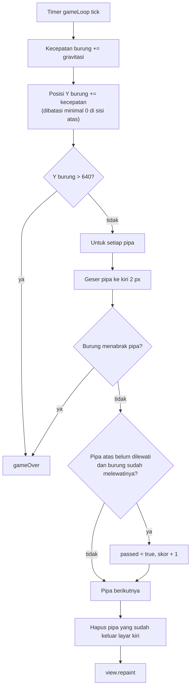
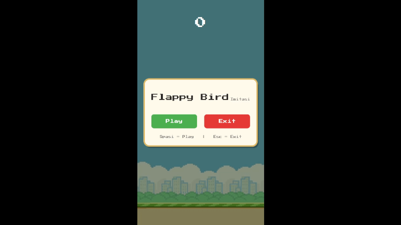
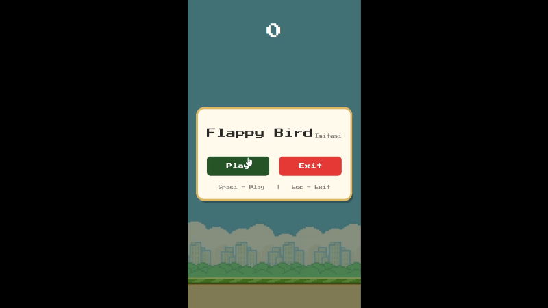
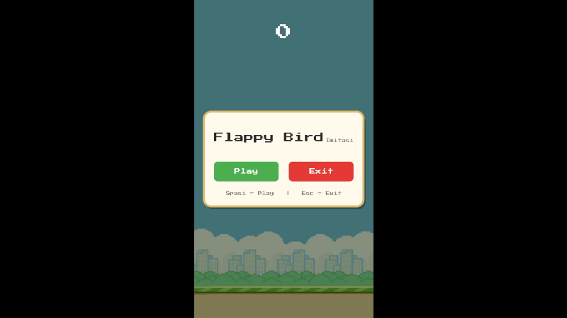

# Flappy Bird (Imitasi)

Game Flappy Bird sederhana berbasis **Java Swing** (`JFrame`, `JPanel`, `Timer`) dengan skor, best score yang tersimpan, menu dan layar game over berbentuk card, font pixel, serta musik latar dan efek suara.

- Ukuran jendela: **360 x 640**
- Bahasa: Java (tanpa library tambahan)
- Font: [Press Start 2P](https://fonts.google.com/specimen/Press+Start+2P) (lisensi OFL)

---

## 1. Desain Program

### 1.1 Struktur Folder

```
.
├── bestscore.txt                  # best score tersimpan (dibuat otomatis)
├── documentationReadME/           # GIF dokumentasi
└── src/
    ├── App.java                   # titik masuk, membuat JFrame
    ├── Logic.java                 # state, game loop, input, audio, skor
    ├── View.java                  # tampilan (gambar scene, card, tombol)
    ├── Player.java                # data burung
    ├── Pipe.java                  # data pipa
    └── assets/
        ├── background.png  bird.png  upperPipe.png  lowerPipe.png
        ├── PressStart2P-Regular.ttf
        ├── theme.wav               # musik latar
        └── Fly.wav                 # efek suara loncat
```

### 1.2 Diagram Kelas

Program memisahkan **logika** (`Logic`) dari **tampilan** (`View`). `Logic` menyimpan seluruh state game, sedangkan `View` hanya membaca state itu lalu menggambarnya.



### 1.3 Tanggung Jawab Tiap Kelas

| Kelas | Tanggung jawab |
|---|---|
| `App` | Membuat `JFrame` (360x640, tidak bisa di-resize), menghubungkan `Logic` dan `View`, lalu menampilkan jendela. |
| `Logic` | Menyimpan state (menu, bermain, game over), menjalankan **game loop** dan timer pipa, memproses keyboard, deteksi tabrakan, penghitungan skor, penyimpanan best score, dan pemutaran audio. |
| `View` | Menggambar background, burung, pipa, skor, serta card menu dan card game over. Memiliki 4 tombol (`Play`, `Exit` di menu; `Restart`, `Exit` di game over) yang ditampilkan sesuai state. |
| `RoundButton` | Tombol bulat kustom (inner class `View`) dengan efek hover dan tekan, supaya tampilan sama di semua Look and Feel. |
| `Player` | Data burung: posisi, ukuran, gambar, dan kecepatan vertikal. |
| `Pipe` | Data pipa: posisi, ukuran, gambar, dan penanda `passed` agar skor tidak dihitung dua kali. |

### 1.4 Parameter Utama

| Parameter | Nilai | Keterangan |
|---|---|---|
| Ukuran frame | 360 x 640 | Sama dengan ukuran `background.png`. |
| Game loop | `Timer(1000/60)` | Sekitar 60 kali per detik. |
| Gravitasi | `+1` per frame | Menambah kecepatan jatuh burung. |
| Kekuatan loncat | `-10` | Kecepatan vertikal saat spasi ditekan. |
| Kecepatan pipa | `-2` px per frame | Pipa bergerak ke kiri. |
| Jeda munculnya pipa | 1500 ms | Lewat `pipeCooldown`. |
| Ukuran burung | 34 x 24 | Titik awal di tengah layar. |
| Ukuran pipa | 64 x 512 | Satu pasang = pipa atas + pipa bawah. |
| Tinggi celah | 160 px (`frameHeight / 4`) | Jarak antara pipa atas dan bawah. |

### 1.5 Fitur Tambahan

- **Pipa acak yang makin sulit.** Posisi celah pipa berikutnya digeser acak dari celah sebelumnya. Batas geseran naik seiring skor: `maxShift = min(200, 50 + skor * 15)` piksel, dan posisi celah dibatasi di rentang 60 sampai 400.
- **Burung miring.** Sudut burung mengikuti kecepatan vertikalnya: menengadah saat naik, menunduk saat jatuh. Sudut dibatasi antara -0,45 dan 1,2 radian. Hitbox tabrakan tetap kotak dan tidak ikut berputar.
- **Best score permanen.** Disimpan di file `bestscore.txt` dan dimuat ulang saat program dibuka.
- **Audio.**
  - `theme.wav` diputar berulang sejak program dibuka, berhenti saat game over, dan mulai dari awal saat Restart.
  - `Fly.wav` diputar setiap loncat dengan volume dasar -12 dB. Jika spasi ditekan beruntun (jarak kurang dari 300 ms), volume turun 3 dB tiap tekanan sampai paling pelan -30 dB, dan suara sebelumnya ditimpa.
  - Jika file audio gagal dimuat, game tetap berjalan tanpa suara.

### 1.6 Kontrol

| Situasi | Tombol | Aksi |
|---|---|---|
| Menu | `Spasi` atau klik **Play** | Mulai game |
| Menu | `Esc` atau klik **Exit** | Keluar program |
| Bermain | `Spasi` | Burung meloncat |
| Game over | `R` atau klik **Restart** | Main lagi |
| Game over | `Esc` atau klik **Exit** | Keluar program |

---

## 2. Penjelasan Alur

### 2.1 Alur Status Game

Game memiliki tiga status yang ditentukan oleh dua variabel di `Logic`, yaitu `started` dan `gameOver`.



| Status | `started` | `gameOver` | Tampil di layar |
|---|---|---|---|
| Menu | `false` | `false` | Background, burung diam, card menu |
| Bermain | `true` | `false` | Burung, pipa, skor di tengah atas |
| Game over | `true` | `true` | Scene terakhir diredupkan, card game over |

### 2.2 Alur Program dari Awal

1. `App.main()` membuat `JFrame`, `Logic`, dan `View`, lalu menghubungkannya dengan `logika.setView(tampilan)`.
2. Constructor `Logic` memuat gambar, memuat best score dari `bestscore.txt`, memuat audio, dan langsung memutar musik latar. Dua timer **dibuat tetapi belum dijalankan**, sehingga game menunggu di menu.
3. `View` menampilkan card menu. Pemain menekan **Spasi** atau tombol **Play**.
4. `startGame()` menjalankan `gameLoop` dan `pipeCooldown`, lalu memanggil `view.updateState()` untuk menyembunyikan tombol menu.
5. Game loop berjalan sampai pemain mati, lalu `gameOver()` menghentikan semuanya dan menampilkan card game over.
6. Pemain memilih **Restart** (state di-reset, kembali ke langkah 5) atau **Exit**.

### 2.3 Alur Game Loop (Setiap Frame)

Timer `gameLoop` memanggil `actionPerformed()` sekitar 60 kali per detik. Tiap panggilan menjalankan `move()` lalu `view.repaint()`.



### 2.4 Alur Pembuatan Pipa

Timer `pipeCooldown` memanggil `placePipes()` setiap 1500 ms:

1. Hitung batas geseran: `maxShift = min(200, 50 + skor * 15)`.
2. Tentukan posisi atas celah baru: `gapTop = lastGapTop + acak(-maxShift .. +maxShift)`, lalu dibatasi ke rentang 60 sampai 400.
3. Buat **pipa atas** dengan sisi bawahnya tepat di `gapTop`.
4. Buat **pipa bawah** dengan sisi atasnya di `gapTop + 160`.
5. Kedua pipa muncul di tepi kanan layar (x = 360) dan bergerak ke kiri.

Semakin tinggi skor, semakin besar kemungkinan celah berpindah jauh naik atau turun, sehingga permainan makin sulit.

### 2.5 Alur Tabrakan dan Skor

- **Tabrakan** memakai pengecekan dua persegi panjang yang saling tumpang tindih (AABB) pada `collision()`: kotak burung dan kotak pipa dianggap bertabrakan bila keempat kondisi tumpang tindih (kiri, kanan, atas, bawah) terpenuhi sekaligus.
- **Game over** terjadi bila burung menabrak pipa atau posisinya melewati dasar layar (Y lebih dari 640). Sisi atas layar tidak mematikan; burung hanya tertahan di Y = 0.
- **Skor** bertambah 1 ketika burung melewati sisi kanan **pipa atas**. Hanya pipa atas yang dihitung agar satu pasang pipa tidak dihitung dua kali, dan penanda `passed` mencegah penghitungan berulang.

### 2.6 Alur Game Over dan Restart

`gameOver()`:
1. Memberi tanda `gameOver = true` (pemeriksaan di awal mencegah dipanggil dua kali dalam satu frame).
2. Menghentikan musik, `gameLoop`, dan `pipeCooldown`.
3. Jika `score > bestScore`, best score diperbarui dan ditulis ke `bestscore.txt`.
4. Memanggil `view.updateState()` agar card game over dan tombolnya tampil.

`restart()`:
1. Mengembalikan burung ke posisi awal dengan kecepatan 0.
2. Mengosongkan daftar pipa dan mereset skor ke 0.
3. Menjalankan ulang kedua timer dan memutar musik dari awal.
4. Memanggil `view.updateState()` agar card dan tombol game over disembunyikan.

### 2.7 Alur Input

`View` memiliki fokus keyboard dan meneruskan `KeyEvent` ke `Logic.keyPressed()`. Aksi yang berlaku bergantung pada status game (lihat tabel kontrol di bagian 1.6). Tombol pada card sengaja dibuat tidak bisa mengambil fokus (`setFocusable(false)`) supaya `Spasi` dan `Esc` tetap diterima `View` walaupun tombol baru saja diklik.

---

## 3. Dokumentasi Saat Program Dijalankan

### Menu Awal

Card menu berisi judul **Flappy Bird** dengan tulisan kecil *Imitasi*, serta tombol **Play** dan **Exit**.



### Bermain Sampai Jatuh (Game Over, Skor 0)

Dari menu, pemain menekan **Play**, lalu burung dibiarkan jatuh sampai melewati dasar layar. Card game over tampil dengan skor 0 dan best score yang tersimpan.



### Restart, Melewati Pipa, lalu Menabrak Pipa

Dari card game over, pemain menekan **Restart**, melewati satu pasang pipa (skor menjadi 1), lalu menabrak pipa berikutnya. Card game over menampilkan skor 1 dan best score, lengkap dengan tombol **Restart** dan **Exit**.


